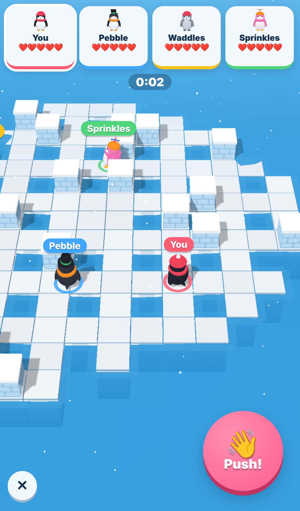
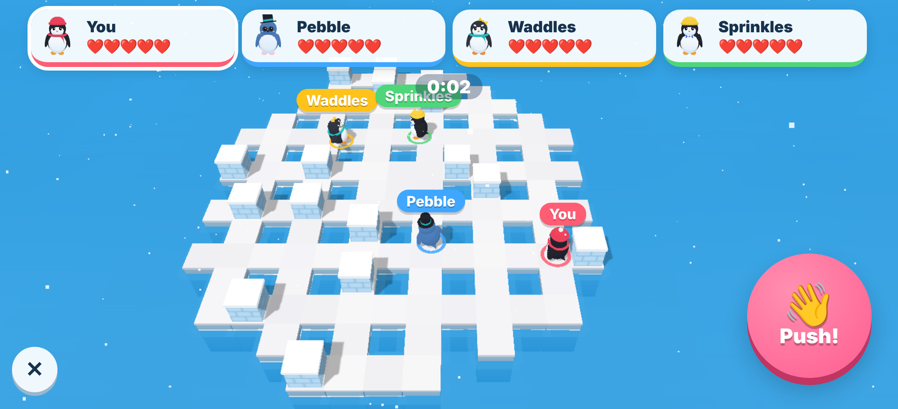
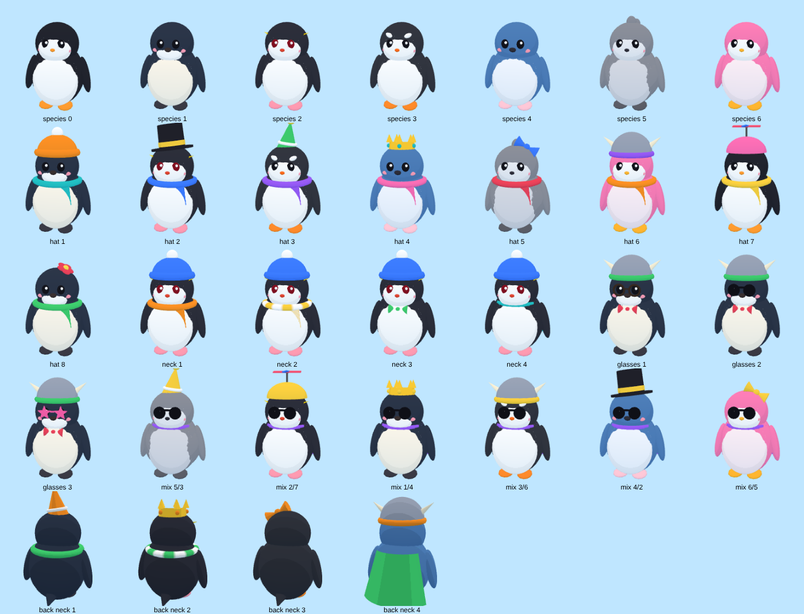

# Penguin Push

Waddle. Shove. **Splash!** A cute 3D penguin party game for phones: push the
other penguins into the sea. Last penguin standing wins. Up to 4 players,
online or against computer penguins, and the wins add up across a session.

| Changing station | Snowball Hill | Ice Grid | Leaderboard |
| --- | --- | --- | --- |
|  |  |  |  |



| A wave sweeping Igloo Cove | Every costume |
| --- | --- |
|  |  |

## How to play

- 🕹️ Put your thumb down anywhere and drag to waddle. On a keyboard: <kbd>WASD</kbd> / arrow keys. Nearly-straight snaps to straight, and walking straight eases you into the middle of your row of tiles, so bridges and corridors are easy. Let go and you stop. Getting shoved is what sends you sliding.
- 😬 Walk to the edge by accident and your penguin **teeters**, flapping its flippers. Let go or turn back within about half a second and you're safe; keep pushing toward the water and in you go. Getting shoved, belly-sliding or standing on polished ice gives no second chance. The computer penguins teeter too, and now and then a clumsy one blunders in on its own.
- 👋 **Push!** (<kbd>Space</kbd>) slaps everyone in front of you with your flippers. From a standstill it's a nudge of about one tile; **run in** and the shove gets much stronger, so build up speed to send someone into the sea. Bumping into someone just jostles them.
- ✨ The blue power button (<kbd>E</kbd>, or <kbd>Shift</kbd>/<kbd>Q</kbd>/<kbd>F</kbd>/<kbd>Enter</kbd>) uses your power. On a computer the buttons show their keys, and picking up a power tells you which key to press.
- ❤️ You start with 5 lives. Fall in and you lose one, then drop back in from the sky.
- 🫙 Jars pop up on the ice. A **heart** jar gives you a life back. A **fish** jar gives you a power:
  - ❄️ **Snowballs** (×3): auto-aimed, and a hit makes a penguin dizzy for a moment.
  - 🛷 **Belly slide** (×3): a fast dash that knocks anyone in the way flying.
  - 💪 **Mega flippers**: bigger, stronger shoves for 9 seconds.
- The results screen shows a leaderboard. Wins add up for as long as the room (or the solo session) lasts.

### Maps

Every map is a **grid of ice blocks** stuck together, like a Bomberman board turned inside out: the board is ice and the "pillars" are **water squares** you can be shoved into. **Ice blocks** sit on some tiles. You can't walk through them, they stop low snowballs (a long throw arcs over), they block waves, and they stop giant snowballs.

- ⛄ **Snowball Hill**: a stepped pyramid of stacked ice. Two giant snowballs sit on the middle of its front edge, where the only way down is south: a wide lane of clear ice (no water squares, no blocks) running from the pyramid's foot to the shore. Snowballs **only roll downhill**, so get behind one and push. Arrows on the steps show the way. A snowball speeds up at every step, bowls over anyone in the lane, and rolls the whole length of the island into the sea. Then a new one appears at the top. Water squares dot the rest of the lowlands.
- 🧊 **Floe Frenzy**: four little islands split by a cross of water, joined by one-tile bridges, with 2×2 rafts drifting around the outside. The rafts crack and sink now and then.
- 🌊 **Igloo Cove**: red arrows warn of a big wave. It shoves everyone across the ice unless you hide behind the igloo or an ice block. There are holes, and slippery polished tiles.
- 🔲 **Ice Grid**: the full inside-out Bomberman board, with water at every other tile and ice blocks scattered on the rest. It's different every match.
- 🔀 **Mix it up**: a different map each round.

**Sudden death** starts after 75 seconds. Tiles shake, then sink one by one from the outside in, until only a small connected patch in the middle is left. The ice blocks crumble too, and heart jars stop appearing.

### Changing station

A brand-new player gets a random penguin name and a surprise outfit, saved straight away; change either whenever you like.

Pick a penguin type (Classic, Emperor, Rockhopper, Gentoo, Little Blue, Fluffy Chick, Bubblegum), a hat (beanie, top hat, party hat, crown, bow, viking, propeller, flower), a scarf, stripy scarf, bow tie or cape, colours, and glasses. Your look is saved, and friends see it online.

## Running it

```bash
npm install
npm run dev          # http://localhost:3000 (static site)
npm run dev:relay    # netplay relay on :8788, only needed for "Play with Friends" locally
```

```bash
npm run check        # lint + typecheck + net:check + unit tests + Playwright e2e
npm run build        # dist/: minified, SW precache + version.json stamped
npm run deploy       # build + netlify deploy --prod --dir=dist (link a Netlify site first)
```

### Music

The soundtrack is synthesized live in the browser, with no audio files. `songs.js` holds the song sheets: tempo, chords and notes on a 16th-note grid, all in C major. `music.js` plays them on little Web Audio instruments (bell, pluck, bass, chord stab, kick, snare, hi-hat), scheduled slightly ahead on the audio clock so timing stays tight.

- A calm theme plays on the menus, a bouncy one in matches, and a faster, driving one once the ice starts cracking. A short fanfare plays when someone wins.
- Themes change at the next bar line, and the music dips briefly under big sound effects (splashes, giant snowballs).
- 🎵 turns the music off on its own, and 🔊 mutes everything. Both settings are remembered.

### Offline and updates

`public/sw.js` is a service worker. `npm run build` stamps it with a version hash and the full list of shipped files. The first visit caches the whole game, so it then plays **offline**, including `?room=` links (solo play works offline; friend rooms need the network). On each visit, and whenever the tab comes back into view, the page checks for a new deploy. The new version installs in the background and is used from the next launch, but never mid-match in a friend room. The worker is off on `localhost` so dev edits show up immediately; add `?sw=1` to test it locally.

## How it's built

There is no bundler: it's static files. ES modules live under `public/src/`. Three.js is
vendored at `public/vendor/three.module.min.js` and the 3D penguins are built from
primitives with toon shading, so there are no model files. The code uses JSDoc
types checked by `tsc --checkJs`, the same conventions as the
[pomelo-penguin](https://github.com/fongandrew/pomelo-penguin) games.

Multiplayer runs on **netplay**, the multiplayer engine from pomelo-penguin.
`npm run net:sync` copies its browser half into `public/src/net/`. It also copies
the server core and the Node `ws` adapter into `relay/` for local dev and tests.
It reads from a sibling checkout at `../pomelo-penguin` (override with
`NETPLAY_REPO=...`). Don't hand-edit those copies. Production uses the shared
relay at `pomelo-play.pomelopenguin.workers.dev`, whose origin allowlist already
covers `*.pomelopenguin.com`. A new game needs no server changes.

How the game maps onto netplay's three state categories (`public/src/multi.js`):

- **Seed-derived**: the whole map, built from the room seed and the match number:
  island shape, hill, floe drift and sinking, wave timing, and every jar's time,
  place and contents. None of it is sent over the network.
- **Owned**: penguins. Each player simulates their own penguin. The host (lowest
  connected slot) simulates the computer penguins and anyone who dropped off.
  Snapshots go out at about 20 Hz and other screens interpolate them. Shoving
  someone sends a `push` event, and the owner of that penguin applies it.
- **Contested**: jars and resting giant snowballs. Claims are relay events
  replayed in relay order through the pure `applyClaim` reducer, with your own
  unconfirmed claims layered on top. Knock-outs are events too, so every screen
  agrees on the finishing order.

| File | What |
| --- | --- |
| `arena.js` | the tile board (levels, water, ice blocks, sudden-death crack order), seed-derived hazards and jars, the downhill-only grid snowball roll |
| `board3d.js` | the board in 3D: instanced ice tiles, blocks, rafts, surf, sinking tiles, snowball arrows |
| `physics.js` / `game.js` | ice movement, shoves, bumps, powers, falls, match end, tally |
| `ai.js` / `nav.js` | computer penguins / grid route-finding around walls and holes |
| `contest.js` | contested-claim reducer |
| `multi.js` / `solo.js` | online session (wire format, ownership, keyframes) / solo link |
| `penguin3d.js` / `render.js` | penguin models + animation / the Three.js scene |
| `songs.js` / `music.js` | the soundtrack as data / the synth and sequencer that plays it |
| `ui.js` / `input.js` / `audio.js` / `main.js` | DOM screens, touch stick + buttons, synth SFX, wiring |

The test hook `window.__game` exposes `state`, `startSolo`, `teleport`, `kickBall`,
`skipTo`, `createRoom` and `joinRoom`. Playwright specs read state through it,
not through pixels.
