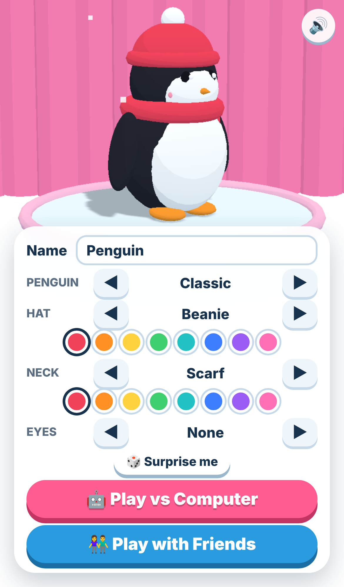
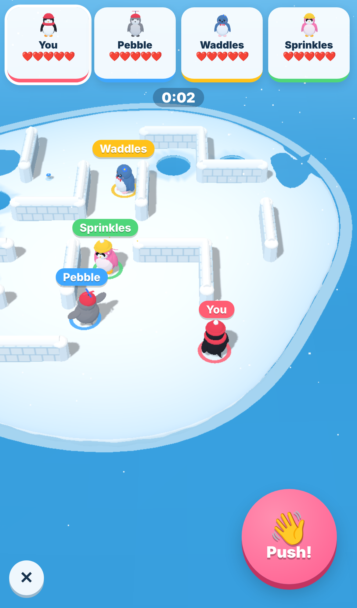
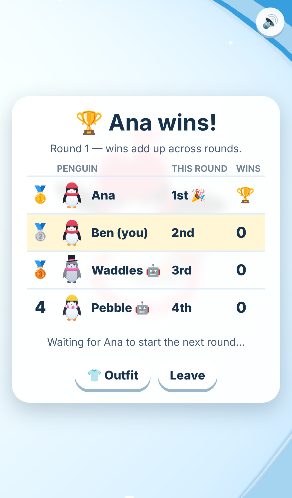
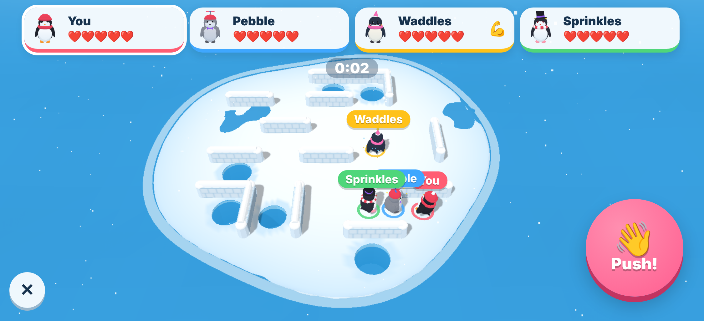

# Penguin Push

Waddle. Shove. **Splash!** A cute 3D penguin party game for phones: push the
other penguins into the sea. Last penguin standing wins. Up to 4 players,
online or against computer penguins, and the wins add up across a session.

| Changing station | Snowball Hill | Ice Maze | Leaderboard |
| --- | --- | --- | --- |
|  |  |  |  |




## How to play

- 🕹️ Put your thumb down anywhere and drag to waddle (WASD / arrows on a keyboard).
- 👋 **Push!** (Space) slaps everyone in front of you with your flippers.
- ❤️ You start with 5 lives. Fall in and you lose one, then drop back in from the sky.
- 🫙 Jars pop up on the ice. A **heart** jar gives you a life back. A **fish** jar gives you a power:
  - ❄️ **Snowballs** (×3): auto-aimed, and a hit makes a penguin dizzy for a moment.
  - 🛷 **Belly slide** (×3): a fast dash that knocks anyone in the way flying.
  - 💪 **Mega flippers**: bigger, stronger shoves for 9 seconds.
- After 90 seconds the ice starts cracking from the edges (sudden death).
- The results screen shows a leaderboard. Wins add up for as long as the room (or the solo session) lasts.

### Maps

Every map has **holes in the ice** to shove people into, and most have **snow walls**. You can't walk through walls, and they stop low snowballs (a long throw arcs over). Walls also block waves, and they bounce giant snowballs.

- ⛄ **Snowball Hill**: two giant snowballs sit on a ridge, each at the top of a lane between snow walls. Snowballs **only roll downhill**: you have to get behind one (uphill) and push. Pushing from below does nothing. Arrows on the snow show which way each one will go. It rolls down its lane, bowls over anyone in it, and drops into the holes and crack at the bottom. Then it respawns at the top.
- 🧊 **Floe Frenzy**: a small iceberg with fishing holes and a crack, ringed by drifting floes that carry you around. The floes crack and sink now and then.
- 🌊 **Igloo Cove**: red arrows warn of a big wave. It shoves everyone across the ice unless you hide behind the igloo, a rock or a snow wall. It also has holes and shiny slippery patches.
- 🧩 **Ice Maze**: a maze of snow walls, different every match. Extra gaps make loops, so you're never cornered for good. The dead ends have holes in them.
- 🔀 **Mix it up**: a different map each round.

In sudden death the snow walls crumble, so nobody can hide behind one forever. Heart jars also stop appearing.

### Changing station

Pick a penguin type (Classic, Emperor, Rockhopper, Gentoo, Little Blue, Fluffy Chick, Bubblegum), a hat (beanie, top hat, party hat, crown, bow, viking, propeller, flower), a scarf, stripy scarf, bow tie or cape, colours, and glasses. Your look is saved, and friends see it online.

## Running it

```bash
npm install
npm run dev          # http://localhost:3000 (static site)
npm run dev:relay    # netplay relay on :8788, only needed for "Play with Friends" locally
```

```bash
npm run check        # lint + typecheck + net:check + unit tests + Playwright e2e
npm run build        # dist/: minified, SW precache + version.json stamped
npm run deploy       # build + netlify deploy --prod --dir=dist (link a Netlify site first)
```

## How it's built

There is no bundler: it's static files. ES modules live under `public/src/`. Three.js is
vendored at `public/vendor/three.module.min.js` and the 3D penguins are built from
primitives with toon shading, so there are no model files. The code uses JSDoc
types checked by `tsc --checkJs`, the same conventions as the
[pomelo-penguin](https://github.com/fongandrew/pomelo-penguin) games.

Multiplayer runs on **netplay**, the multiplayer engine from pomelo-penguin.
`npm run net:sync` copies its browser half into `public/src/net/`. It also copies
the server core and the Node `ws` adapter into `relay/` for local dev and tests.
It reads from a sibling checkout at `../pomelo-penguin` (override with
`NETPLAY_REPO=...`). Don't hand-edit those copies. Production uses the shared
relay at `pomelo-play.pomelopenguin.workers.dev`, whose origin allowlist already
covers `*.pomelopenguin.com`. A new game needs no server changes.

How the game maps onto netplay's three state categories (`public/src/multi.js`):

- **Seed-derived**: the whole map, built from the room seed and the match number:
  island shape, hill, floe drift and sinking, wave timing, and every jar's time,
  place and contents. None of it is sent over the network.
- **Owned**: penguins. Each player simulates their own penguin. The host (lowest
  connected slot) simulates the computer penguins and anyone who dropped off.
  Snapshots go out at about 20 Hz and other screens interpolate them. Shoving
  someone sends a `push` event, and the owner of that penguin applies it.
- **Contested**: jars and resting giant snowballs. Claims are relay events
  replayed in relay order through the pure `applyClaim` reducer, with your own
  unconfirmed claims layered on top. Knock-outs are events too, so every screen
  agrees on the finishing order.

| File | What |
| --- | --- |
| `arena.js` | maps (holes and walls as capsules, seeded maze), seed-derived hazards and jars, the downhill-only snowball rule and roll sim |
| `physics.js` / `game.js` | ice movement, shoves, bumps, powers, falls, match end, tally |
| `ai.js` / `nav.js` | computer penguins / grid route-finding around walls and holes |
| `contest.js` | contested-claim reducer |
| `multi.js` / `solo.js` | online session (wire format, ownership, keyframes) / solo link |
| `penguin3d.js` / `render.js` | penguin models + animation / the Three.js scene |
| `ui.js` / `input.js` / `audio.js` / `main.js` | DOM screens, touch stick + buttons, synth SFX, wiring |

The test hook `window.__game` exposes `state`, `startSolo`, `teleport`, `kickBall`,
`skipTo`, `createRoom` and `joinRoom`. Playwright specs read state through it,
not through pixels.
